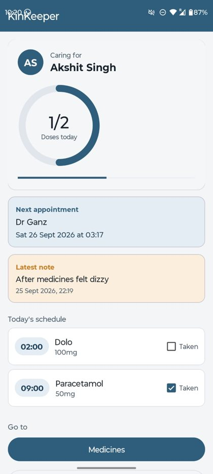
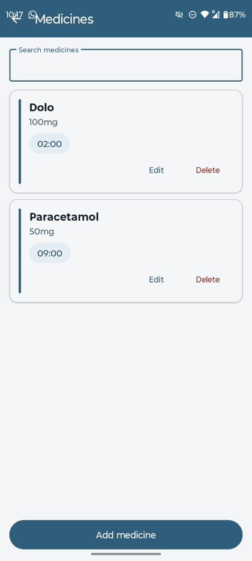
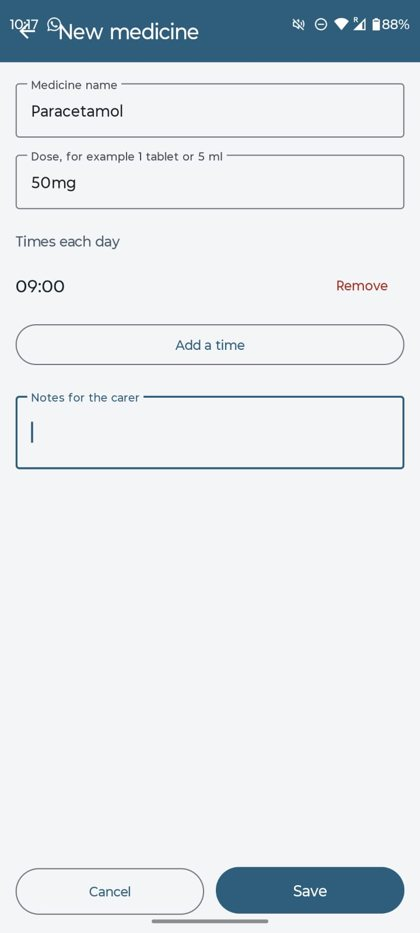
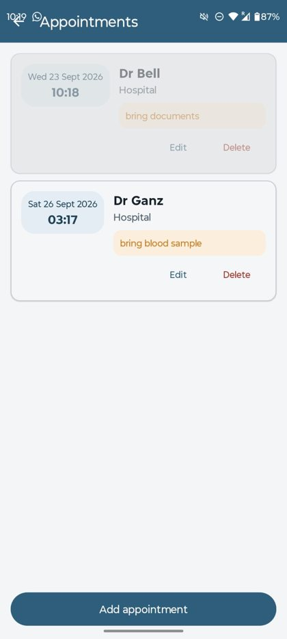
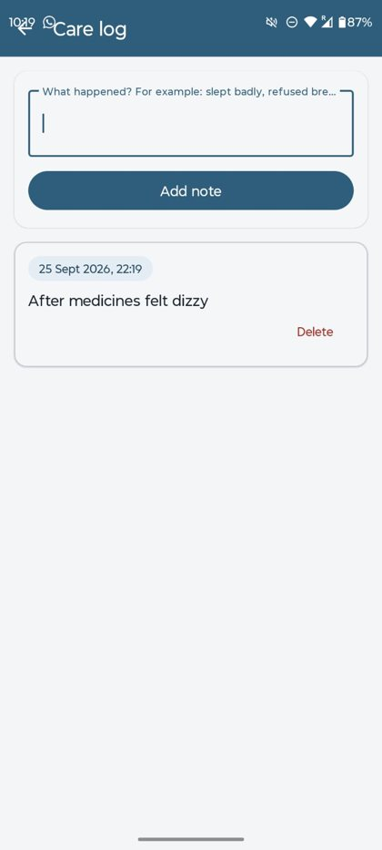
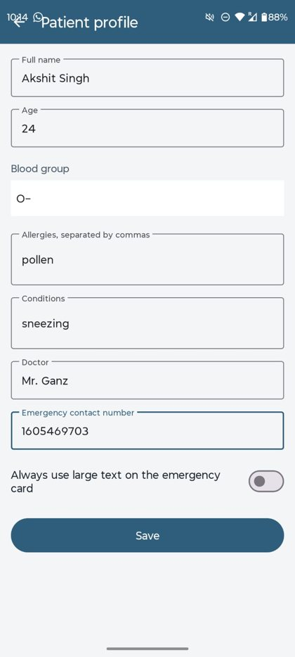
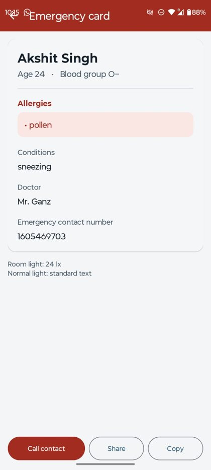
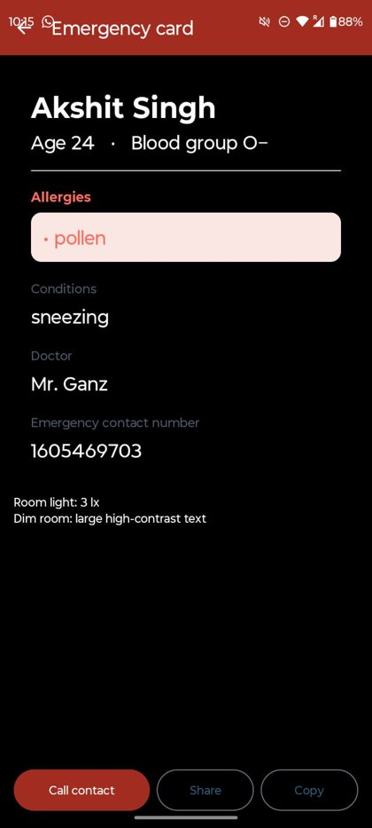
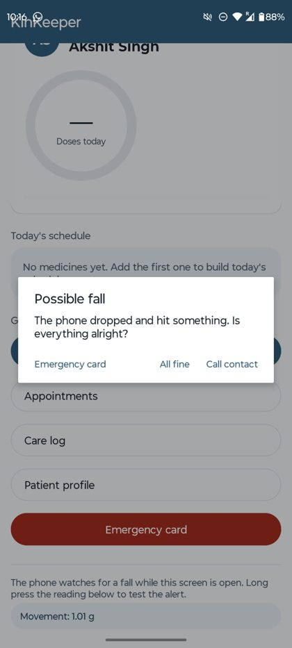

# KinKeeper

**An Android app for keeping track of an elderly parent's medicines, appointments and emergency details.**

Written in Kotlin for a university Mobile Systems module. Everything stays on the phone — no account, no network access, and the app requests **no permissions at all**.


---

## The problem

Someone caring for an elderly parent has to hold a lot in their head at once: which tablets are due at which hour, whether this morning's dose was actually taken, when the next appointment is, how the patient has been sleeping — and, if something goes wrong, what a paramedic needs to know in the first thirty seconds.

KinKeeper keeps all of that in one place, and uses the phone's sensors for the two moments that matter most: a fall, and reading the emergency card in a dark hallway at three in the morning.

---

## Screens

| Home | Medicines | Add / edit medicine |
|:---:|:---:|:---:|
|  |  |  |
| Today's doses in clock order, with a custom-drawn progress ring. The next appointment and most recent care note appear only when they have something to show. | A `RecyclerView` with a search box that filters by name or dose on every keystroke. | Receives a medicine through an `Intent` and hands the edited one back. Times come from a `TimePickerDialog`. |

| Appointments | Care log | Patient profile |
|:---:|:---:|:---:|
|  |  |  |
| Sorted soonest first. Appointments that have already passed fade back to 45% opacity. | A dated diary of how the patient has been, newest first — ready for the next consultation. | The source of everything on the emergency card. |

---

## The two sensors

The sensors do real work here rather than simply displaying a number.

### Ambient light — the emergency card reads itself out in the dark

| Normal room light (24 lx) | Dim room (3 lx) |
|:---:|:---:|
|  |  |

Below **20 lux** the card switches itself to a black background with larger, brighter text. It only switches **back above 30 lux**.

Those two different thresholds are deliberate. With a single threshold, a reading hovering at the boundary flips the entire screen several times a second. Using separate on and off values to prevent that is called **hysteresis** — the same principle as a thermostat's dead band.

### Accelerometer — fall detection



The three axis readings are combined into one magnitude with Pythagoras and divided by gravity, giving a value in *g*:

```kotlin
val gForce = sqrt(x * x + y * y + z * z) / SensorManager.GRAVITY_EARTH
```

A phone at rest reads about **1.0 g**, because gravity acts on the sensor even when the device is still. In free fall nothing pushes back, so the reading drops close to **0**.

A single impact spike is not enough to conclude anything — setting the phone down firmly produces one, and so does picking it up quickly. So the detector looks for the **two-part signature of a real fall**:

1. **Free fall** — the reading drops below `0.4 g`
2. **Impact within 1.2 seconds** — it spikes above `2.5 g`

Only that sequence raises the alert, and an eight-second cooldown stops a bouncing phone triggering it twice.

**The app never dials on its own.** A dropped phone is far more likely than a dropped person, so auto-calling would mean frequent false alarms to an emergency contact — and people would turn the feature off. The carer chooses: *All fine*, *Emergency card*, or *Call contact*.

<br clear="right" />

---

## Architecture

Three layers, and no layer reaches past the one below it.

```
   ACTIVITIES + ADAPTERS        8 screens, 4 list adapters.
   (what you see)               They display data and handle taps.
          │                     They never touch storage directly.
          │  ask for / hand over data
          ▼
   StorageService               One file — the only code in the app that
   (the single door to storage) reads or writes SharedPreferences.
          │
          │  reads / writes JSON text
          ▼
   MODELS                       Medication, Appointment, CareNote,
   (plain data)                 PatientProfile, DoseItem.
                                They convert themselves to and from JSON.
```

Replacing SharedPreferences with Room would change exactly one file. The eight screens would carry on unaware.

Two decisions follow from the same instinct:

**Today's schedule is computed, never stored.** It is derived from the medicines and their times, so editing a medicine cannot leave a stale schedule behind. There is only one copy of the truth.

**Ticked doses expire by being ignored.** The record stores today's date alongside the set of ticked doses; if that date is not today's, the set reads as empty. No timer, no alarm, no background job — yesterday's ticks are simply never read.

---

## Project structure

```
app/src/main/
├── AndroidManifest.xml              all 8 Activities declared here
├── java/com/kinkeeper/
│   ├── HomeActivity.kt              dashboard · accelerometer / fall detection
│   ├── MedicationsActivity.kt       list + search · sends data to the form
│   ├── MedicationFormActivity.kt    receives it, sends it back
│   ├── AppointmentsActivity.kt
│   ├── AppointmentFormActivity.kt
│   ├── CareLogActivity.kt
│   ├── ProfileActivity.kt
│   ├── EmergencyActivity.kt         emergency card · light sensor · implicit intents
│   ├── models/                      Medication, Appointment, CareNote,
│   │                                PatientProfile, DoseItem
│   ├── services/StorageService.kt   all saving and loading
│   ├── views/DoseRingView.kt        the custom Canvas-drawn view
│   └── adapters/                    the 4 RecyclerView adapters
└── res/
    ├── layout/                      13 layouts
    ├── values/                      colours, strings, theme
    └── drawable/                    shapes and icons
```

The source is commented throughout, explaining why each piece works the way it does rather than restating what the code says.

---

## Built with

| | |
|---|---|
| **Language** | Kotlin |
| **Min / target SDK** | 34 / 35 (Android 14 / 15) |
| **UI** | Views with XML layouts, Material Design 3, view binding |
| **Lists** | `RecyclerView` ×4, each with its own adapter and `ViewHolder` |
| **Custom drawing** | `DoseRingView` — arcs and text on a `Canvas`, animated with `ValueAnimator` |
| **Navigation** | Explicit `Intent`s; `registerForActivityResult` for the edit round trip |
| **Sensors** | `TYPE_ACCELEROMETER`, `TYPE_LIGHT` |
| **Storage** | `SharedPreferences` holding JSON (`org.json`) |
| **Interop** | Implicit intents — `ACTION_DIAL` to call, `ACTION_SEND` to share |

No third-party libraries beyond AndroidX and Material Components.

### Why no permissions

Calling uses `ACTION_DIAL`, which opens the dialler with the number filled in and lets the user press call, rather than `ACTION_CALL`, which places the call itself and requires `CALL_PHONE`. Everything else stays inside the app's own sandbox.

---

## Running it

```bash
git clone https://github.com/<your-username>/kinkeeper.git
```

Open the folder in **Android Studio** (2025.1 or newer), let Gradle sync, then run on an emulator or device with **API 34 or higher**.

### Trying the sensors

**Light sensor** — open the emergency card and cover the top of the phone. Below 20 lux it switches to high contrast.
On an emulator: *Extended controls → Virtual sensors → Additional sensors → Light*.

**Fall detection** — the home screen watches for free fall followed by an impact. To see the alert without dropping your phone, **long press the movement reading** at the bottom of the home screen; it raises the same dialog the sensor would.
On an emulator: *Extended controls → Virtual sensors → Move*.

---

## Limitations

Worth being straight about these.

- **Fall detection is not calibrated.** The thresholds were reasoned about rather than tested against recorded falls. A slow collapse against a wall involves no free fall and would go undetected.
- **It only runs in the foreground.** Background detection would need a foreground service, its own permission and a persistent notification.
- **No automated tests.** The JSON round trip in the models and `todaySchedule()` are pure logic with no UI, and would be the natural first ones.
- **Data is not encrypted.** It is private to the app's sandbox, but real medical records would need encryption and a device passcode requirement.
- Lists refresh with `notifyDataSetChanged()` rather than `DiffUtil` — invisible at this data size, but the latter is what I would use if they grew.

## Possible next steps

- **Reminders** when a dose is due — the app already knows every time of day
- **Document scanning** with on-device ML Kit, to read a pill bottle label straight into the medicine form
- **Room** in place of SharedPreferences for multiple patients; because everything goes through `StorageService`, that would change one file

---

## About

Built as the final project for **Mobile Systems (MobSys 2026)**.

Requirements the module set, and where each is met:

| Requirement | Where |
|---|---|
| At least 3 Activities | 8 — all declared in `AndroidManifest.xml` |
| Pass data to the next Activity **and back** | `MedicationsActivity` ⇄ `MedicationFormActivity` |
| A CustomView inside an Activity | `views/DoseRingView.kt`, on the home screen |
| A RecyclerView | 4 of them, in `adapters/` |
| Read and use two sensors | Accelerometer and ambient light |
